# Borno Pulse ⚡️

<p align="center">
  <strong>Smart Mac Utilities & System Monitor</strong><br>
  <em>A native, production-grade macOS Super Utility Suite engineered in Swift 6 & SwiftUI.</em><br>
  Provided by <strong><a href="https://bornosoft.bd">BornoSoft</a></strong> • Free & Open Source under the <a href="LICENSE">MIT License</a>.
</p>

<p align="center">
  <a href="https://github.com/kazinayeem/Borno-Pulse"></a>
  <a href="LICENSE"></a>
  <a href="docs/BUILDING.md"></a>
  <a href="docs/SCREEN_INVENTORY.md"></a>
</p>

---

## 1. Overview

**Borno Pulse** brings professional hardware telemetry, developer utilities, storage treemap analytics, cache cleanup, offline image & PDF tools, screen time tracking, and an interactive menu bar utility popover into a unified native macOS experience.

Engineered with an **offline-first philosophy**, Borno Pulse contacts no remote analytics servers, performs no cloud telemetry, and keeps all sensitive user clipboard data, backups, and metrics strictly on your local device.

### Highlights
- 📊 **Hardware Telemetry Engine**: Per-core CPU load, Metal GPU utilization, Mach virtual memory pressure, swap footprint, and APFS purgeable volume tracking.
- 🔋 **Empirical Battery Estimation**: Real-time power draw in Watts, empirical decay slope ($\%/hr$), lithium-ion saturation curve compensation, and 7-day retention persistence.
- 💻 **Clamshell Mode (Lid-Closed Operation)**: Native IOKit sleep assertions keeping Docker, local servers, and background scripts running with the lid closed, complete with duration presets, countdown timer, hardware audit, and workload verification.
- 🌐 **Developer & Port Manager**: BSD listening socket auditor (`*:3000`, `127.0.0.1:8000`), dev server detection (Vite, Next.js, Django, FastAPI), Docker port correlation, JSON studio, JWT claim decoding, and ICMP ping latency graphs.
- 📄 **Offline PDF Studio**: 12 local tools including an interactive PDF Canvas Editor, Images to PDF, Merge, Split, Lossless Compression, and Apple Neural Engine Vision OCR.
- 📋 **Privacy-Preserving Clipboard**: Local clipboard history with automated credential & API key masking.
- ⚡️ **Menu Bar Utility Widget & Quick Actions**: Compact 4-category menu bar popover (Audio Mixer, Battery Telemetry, Hardware Load, 21-Action Icon Grid) with customizable status item metric tokens.
- 🎨 **Typography & Appearance Engine**: Live Light/Dark/System theme switching, font family selection (SF Pro, New York, SF Mono, Menlo, Helvetica Neue), and font scaling presets.

---

## 2. Visual Tour & Screenshot Gallery

Every screenshot below was captured programmatically from the running, compiled application across **Light Mode** and **Dark Mode** via [`scripts/capture-screenshots.sh`](scripts/capture-screenshots.sh).

### Main Dashboard (Overview)
| Light Mode | Dark Mode |
|:---:|:---:|
| 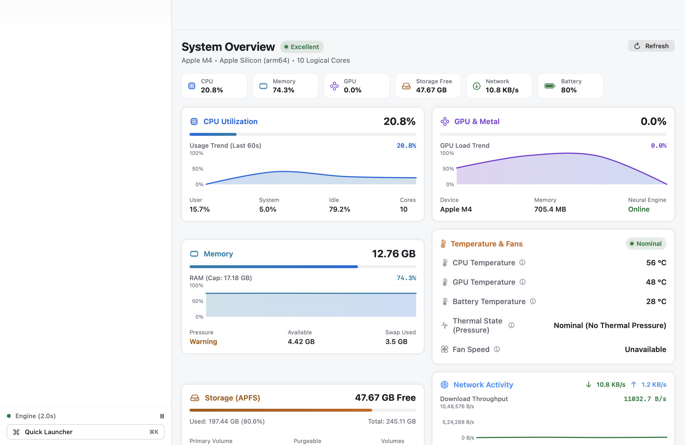 | 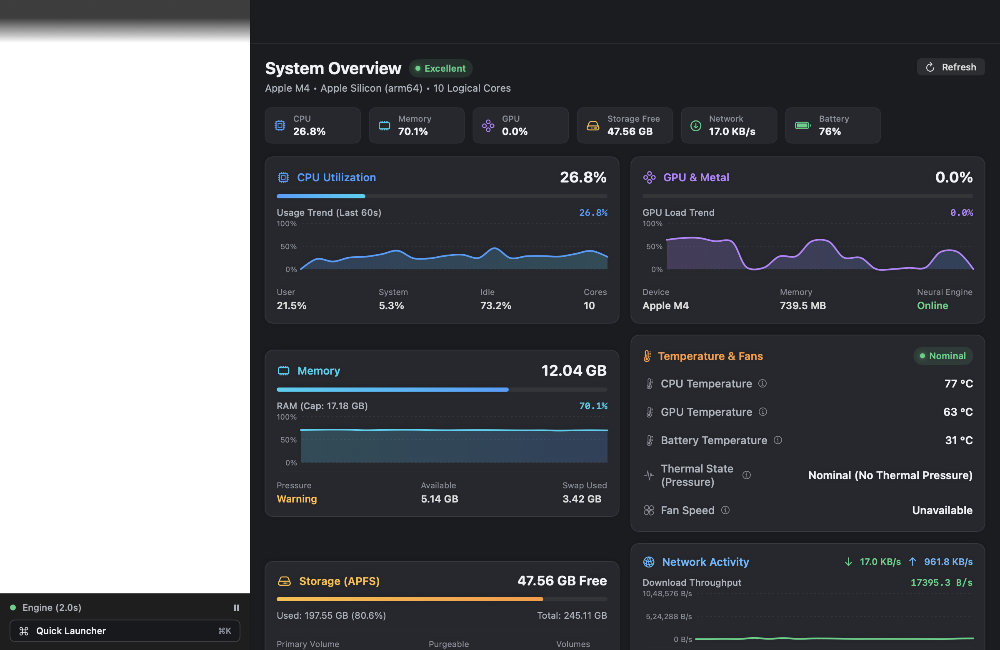 |

### Menu Bar Utility Widget
| Light Widget | Dark Widget |
|:---:|:---:|
| 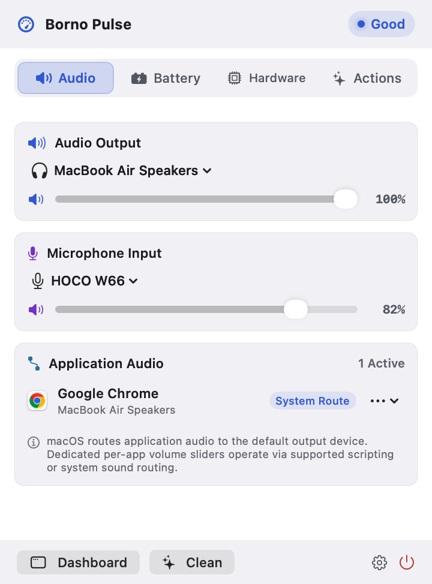 | 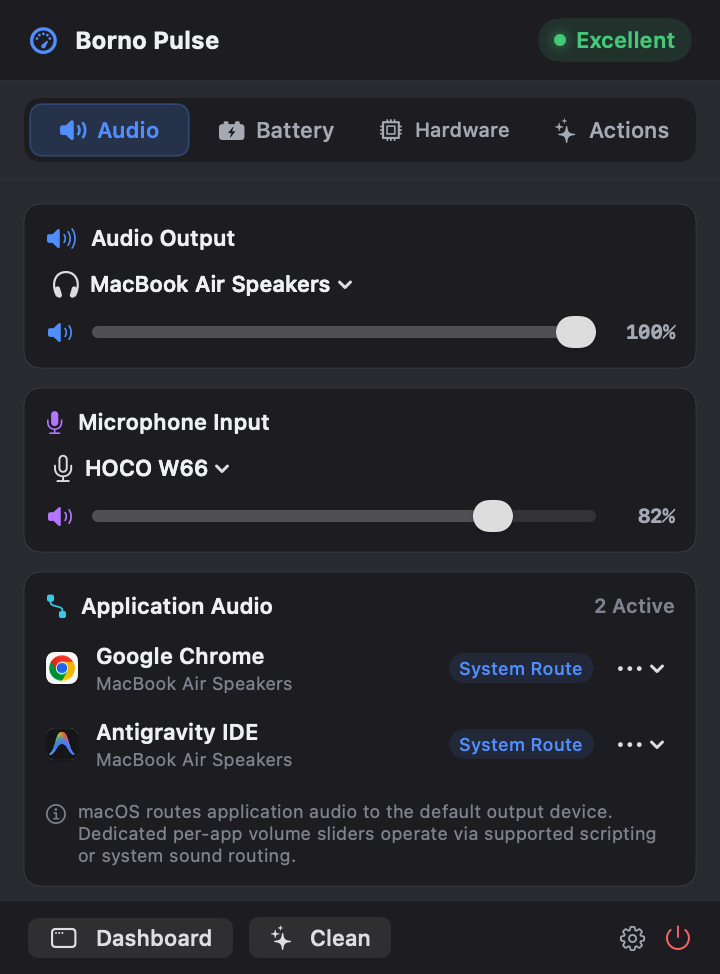 |

### Hardware Telemetry, Clamshell & Developer Tools
| Category | Light Appearance | Dark Appearance |
|:---|:---:|:---:|
| **CPU Monitoring** | 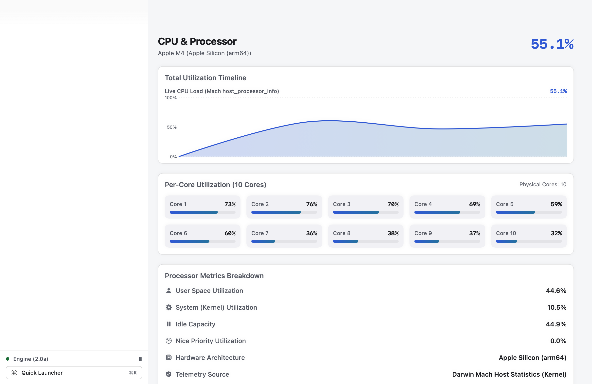 | 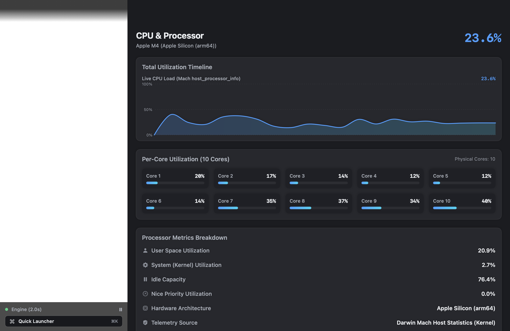 |
| **Clamshell Mode** | 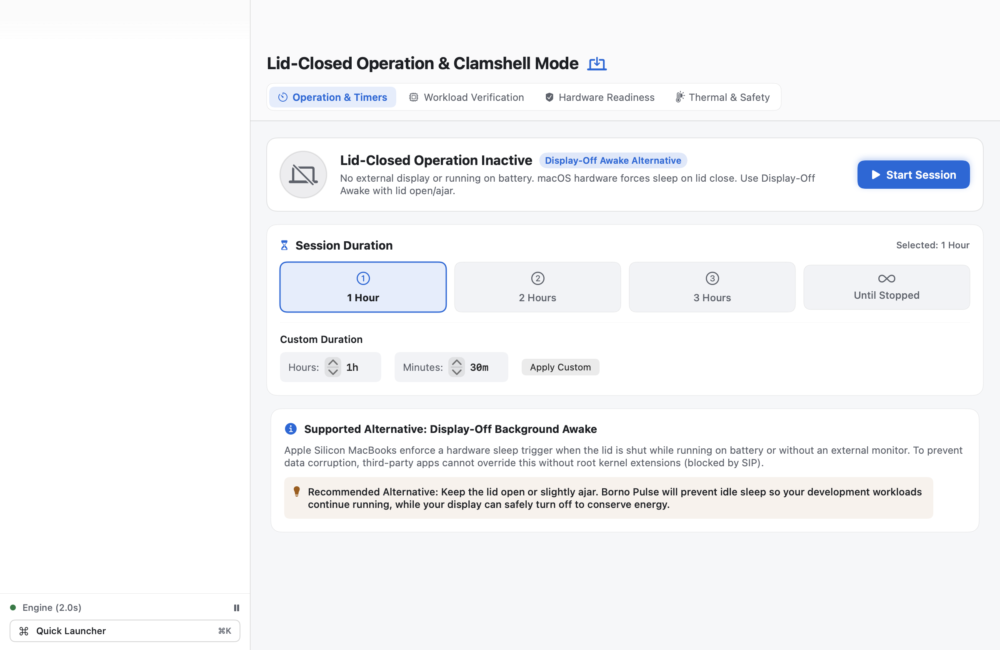 | 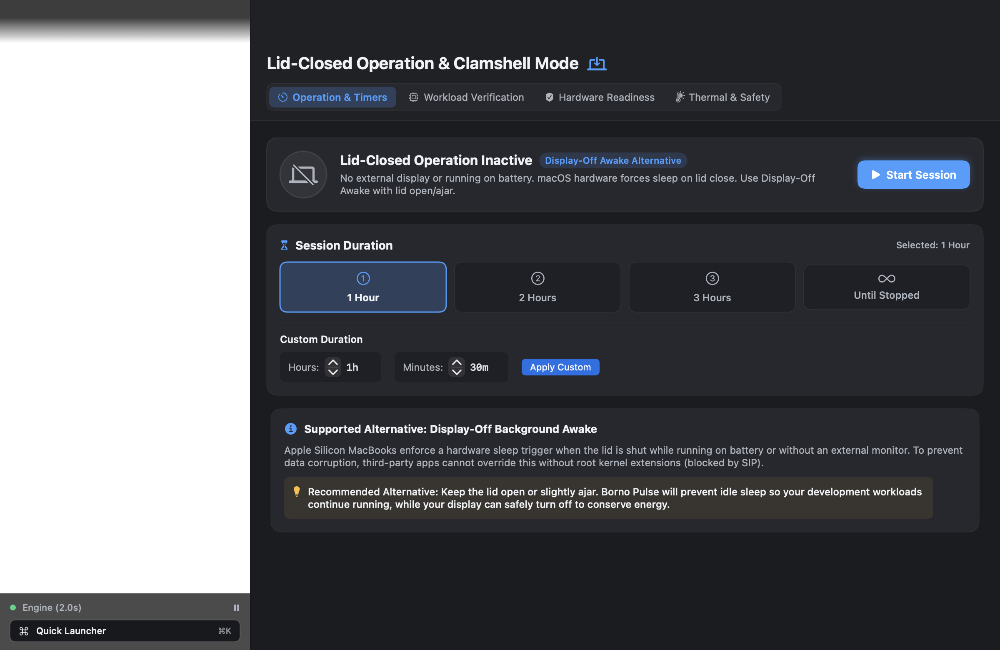 |
| **Port Manager** | 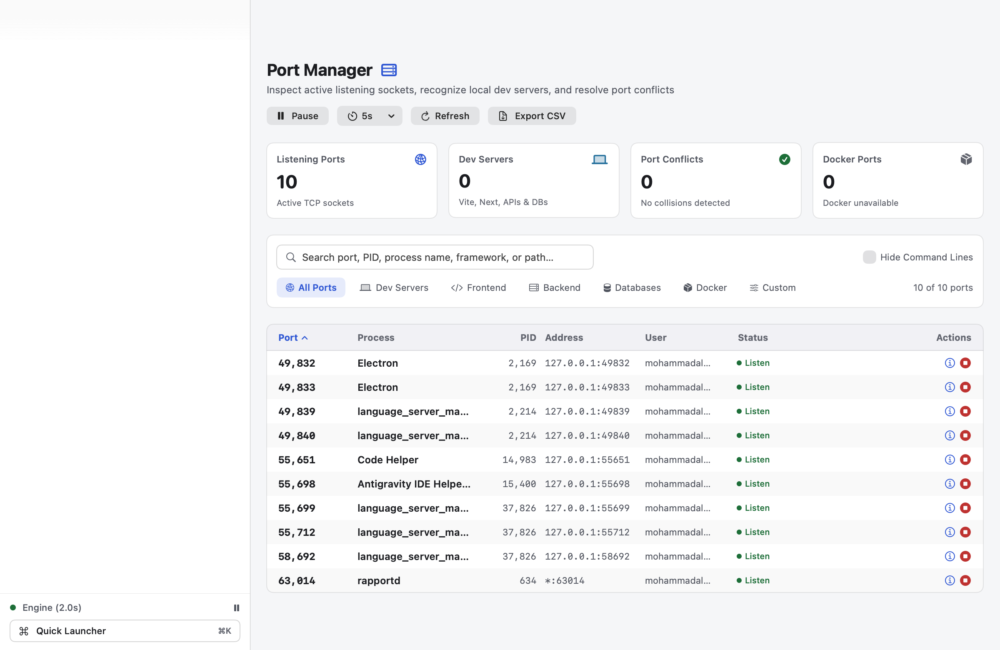 | 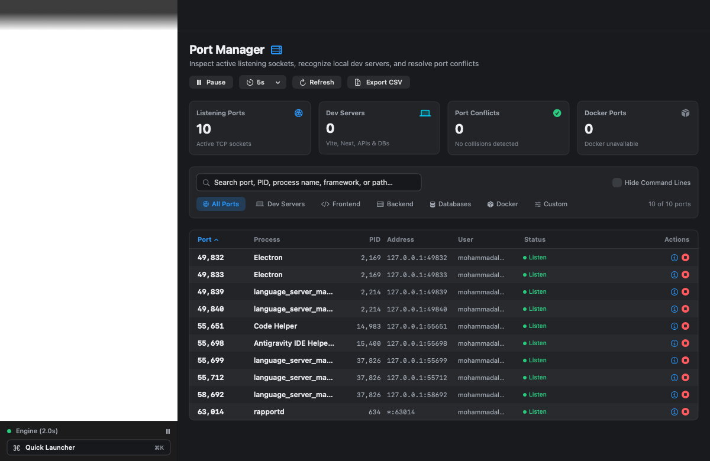 |
| **PDF Studio** | 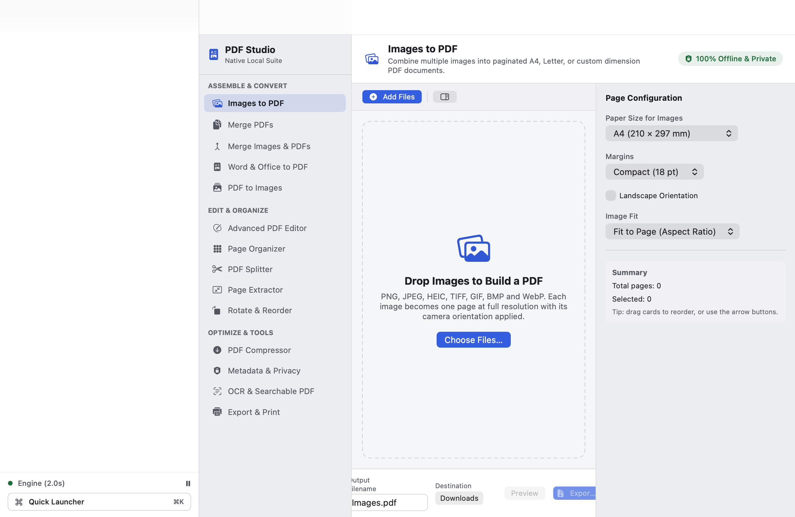 | 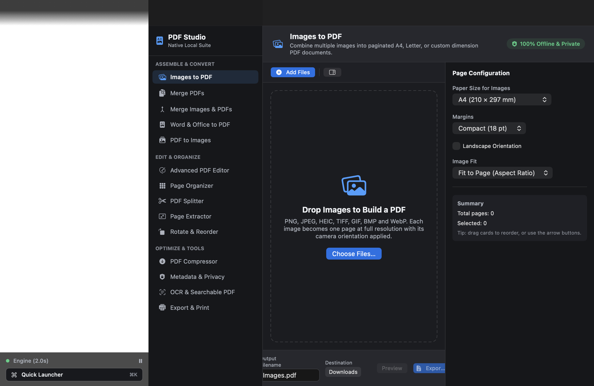 |
| **Settings & Typography** | 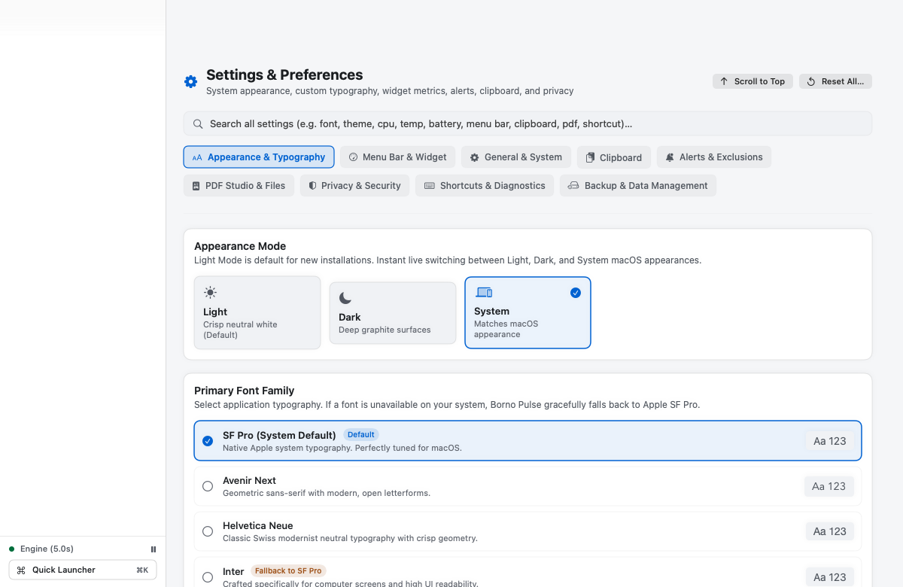 | 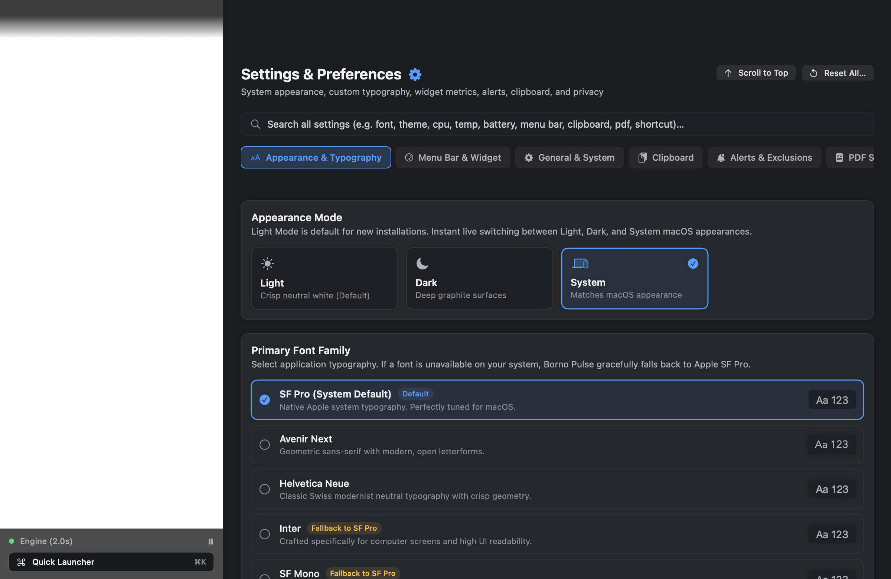 |

*Full visual catalog of all 35 screens and 80 image assets available in [`docs/SCREEN_INVENTORY.md`](docs/SCREEN_INVENTORY.md).*

---

## 3. Implemented Features & Architecture

Borno Pulse includes **25 dedicated navigation sections** and system tools:

```
smart tool/
├── App/
│   └── smart_toolApp.swift              # App entry point, lifecycle, CLI argument router
├── Views/
│   ├── MainDashboardView.swift          # Primary SplitView navigation and command palette
│   ├── Overview/OverviewView.swift      # Real-time hardware telemetry dashboard
│   ├── CPU/CPUDetailView.swift          # Core utilization and load averages
│   ├── GPU/GPUDetailView.swift          # Metal capabilities and ANE status
│   ├── Memory/MemoryDetailView.swift    # RAM pressure, wired memory, and swap
│   ├── Battery/BatteryDetailView.swift  # Wattage, voltage, empirical slope, 7-day history
│   ├── Sensors/SensorsDetailView.swift  # Thermal diode envelopes and fan speeds
│   ├── Storage/StorageDetailView.swift  # APFS capacity and purgeable space
│   ├── Network/NetworkDetailView.swift  # Throughput gauges and BSD getifaddrs
│   ├── Settings/SettingsView.swift      # 9-tab preferences and typography controls
│   └── FileTools/                       # PDF Studio, format converters, and compressors
├── MenuBar/
│   ├── MenuBarCoordinator.swift         # StatusItem button and transient popover manager
│   └── MenuBarPopoverView.swift         # 4-category popover (Audio, Battery, Hardware, Actions)
├── DeveloperTools/
│   ├── PortManager/                     # Local socket scanner, dev server classifier, Docker
│   ├── JSON/                            # Formatter, minifier, interactive tree, and diff
│   ├── JWT/                             # Claim decoding and expiration audit
│   ├── HTTPClient/                      # Local API runner with secret masking
│   └── Docker/                          # Container status and lifecycle controls
├── Services/
│   ├── SystemMonitor.swift              # Background telemetry coordinator
│   ├── BatteryEstimationService.swift   # Slopes, non-linear saturation, and predictions
│   └── ScreenshotAutomationService.swift# Full app automated Retina screenshot capture
└── Tests/
    └── SmartToolTests.swift             # 854+ automated regression and invariant checks
```

*For in-depth per-feature descriptions and access instructions, see [`docs/FEATURES.md`](docs/FEATURES.md).*

---

## 4. System Requirements

- **Operating System**: macOS 14.0 (Sonoma) or macOS 15+ (Sequoia)
- **Architecture**: Universal binary supporting both **Apple Silicon** (`arm64`, M1/M2/M3/M4) and **Intel** (`x86_64`)
- **Toolchain**: Xcode 15.0+ or Xcode 16+
- **Language Standard**: Swift 5.9 / Swift 6.0 with strict concurrency checks enabled
- **External Dependencies**: Zero third-party dependencies; uses only Apple native frameworks (`SwiftUI`, `AppKit`, `IOKit`, `Metal`, `PDFKit`, `Vision`).

---

## 5. Building from Source

### 1. Clone the Repository
```bash
git clone https://github.com/kazinayeem/Borno-Pulse.git
cd Borno-Pulse
```

### 2. Build via Xcode
```bash
open "smart tool.xcodeproj"
```
Select the **`smart tool`** scheme and choose **`My Mac`** as the run destination. Press **⌘R** to build and run.

### 3. Build via Command Line
```bash
# Debug build
xcodebuild -project "smart tool.xcodeproj" \
           -scheme "smart tool" \
           -destination "platform=macOS" \
           -configuration Debug \
           build

# Release build
xcodebuild -project "smart tool.xcodeproj" \
           -scheme "smart tool" \
           -destination "platform=macOS" \
           -configuration Release \
           build
```

### 4. Run Automated Invariant Tests
```bash
APP_BIN=$(find "$HOME/Library/Developer/Xcode/DerivedData" -name "smart tool" -type f -perm +111 -path "*/smart tool.app/Contents/MacOS/*" | head -n 1)
"$APP_BIN" --run-tests
```

### 5. Run Screenshot Automation
```bash
./scripts/capture-screenshots.sh
```

*Full build, signing, and packaging documentation is available in [`docs/BUILDING.md`](docs/BUILDING.md).*

---

## 6. Usage Guide

- **Opening the Dashboard**: Click the Borno Pulse Dock icon or press **⌘O** from the menu bar widget.
- **Command Palette (⌘K)**: Press **⌘K** anywhere to open the Quick Launcher search across all 25 system modules.
- **Menu Bar Utility**: Click the gauge icon in your macOS menu bar to view the 4-category popover.
- **Customizing Metrics**: Navigate to **Settings → Menu Bar & Widget** to add, remove, or reorder the live status item tokens.
- **Appearance & Typography**: Navigate to **Settings → Appearance & Typography** to switch themes or select your preferred font family and scale.
- **Quitting the Application**: Choose **Borno Pulse → Quit Borno Pulse** (**⌘Q**) or click Quit from the menu bar widget actions.

---

## 7. Privacy & Security

Borno Pulse is designed with a **100% local-first architecture**:
- **Zero Remote Telemetry**: No third-party analytics SDKs, trackers, or remote telemetry.
- **Sensitive Credential Protection**: Automated regex redaction for passwords, API keys, and bearer tokens in Clipboard and Port Manager.
- **Local Storage Only**: All settings and history reside strictly inside your user application support directory.

*Read our detailed policy in [`docs/PRIVACY.md`](docs/PRIVACY.md).*

---

## 8. Contributing

Contributions are welcome! Whether you are improving telemetry accuracy, adding new developer tools, or refining UI typography, please review our guidelines:
1. Review [`CONTRIBUTING.md`](CONTRIBUTING.md) for branch guidelines and commit styles.
2. Read the [`CODE_OF_CONDUCT.md`](CODE_OF_CONDUCT.md).
3. Ensure all automated tests pass before opening a Pull Request (`"$APP_BIN" --run-tests`).

---

## 9. License

This project is licensed under the **MIT License**. See the [`LICENSE`](LICENSE) file for complete details.

---

## 10. Support & Attribution

- **BornoSoft**: [https://bornosoft.bd](https://bornosoft.bd)
- **Repository**: [https://github.com/kazinayeem/Borno-Pulse](https://github.com/kazinayeem/Borno-Pulse)
- **Issue Tracker**: [https://github.com/kazinayeem/Borno-Pulse/issues](https://github.com/kazinayeem/Borno-Pulse/issues)
- **Pull Requests**: [https://github.com/kazinayeem/Borno-Pulse/pulls](https://github.com/kazinayeem/Borno-Pulse/pulls)
- **Discussions**: [https://github.com/kazinayeem/Borno-Pulse/discussions](https://github.com/kazinayeem/Borno-Pulse/discussions)
